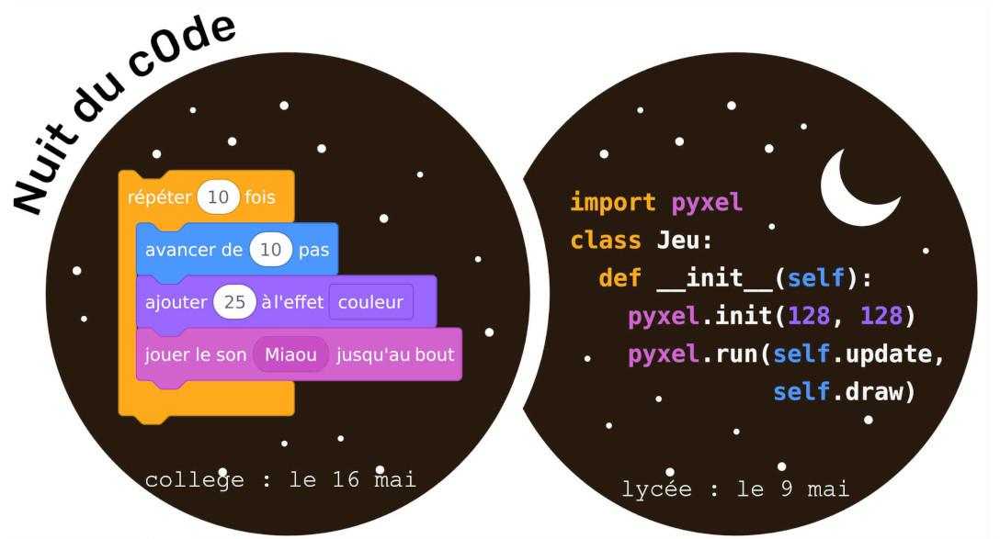
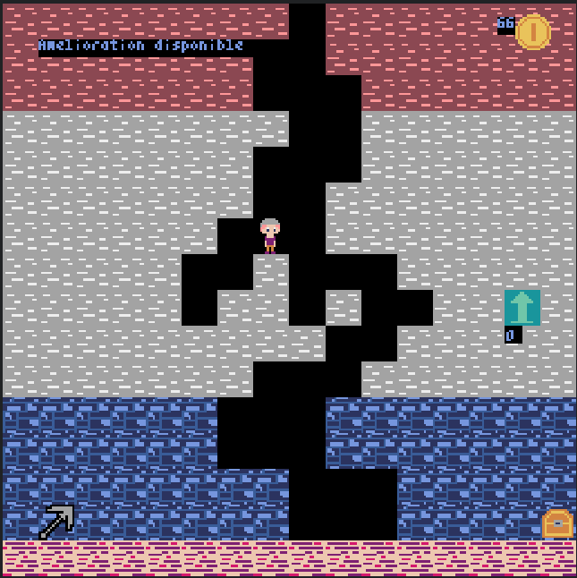
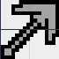

# 🎮 Finding a Treasure in the Void Simulator

### Nuit du Code 2024

**Un jeu d'exploration et de minage en pixel art, développé avec Python et Pyxel.**

**Équipe R.S.A. • Île Maurice 🇲🇺**

---

## 🌍 À propos du jeu

Thomas, un jeune explorateur, arrive sur la mystérieuse planète **Sylva**, où se cacherait un trésor.

Équipé de sa **morpho-pioche**, il doit explorer les profondeurs de la planète, miner différents matériaux, récolter des pièces d'or et améliorer son équipement pour atteindre le coffre au trésor.

Le défi : progresser à travers les différentes couches de la planète en débloquant des outils toujours plus puissants.

---

## 🖼️ Aperçu du jeu

*Capture originale de notre jeu réalisé lors de la Nuit du Code 2024.*

---

## 🕹️ Comment jouer ?

| Commande | Action |
| :---: | --- |
| ⬅️ ⬆️ ⬇️ ➡️ | Déplacer le personnage |
| 🖱️ Clic gauche | Miner les blocs et récupérer des pièces |
| `P` | Mettre le jeu en pause / reprendre |
| `R` | Recommencer après avoir ouvert le coffre |

**Objectif :** atteindre la couche la plus profonde de Sylva, améliorer sa pioche et ouvrir le coffre au trésor.

---

## ⛏️ Minage et améliorations

Le jeu repose sur un système de progression : chaque bloc miné permet de récolter des pièces d'or pour améliorer son outil.

### 🔹 Amélioration de la pioche

- La pioche actuelle est affichée en bas à gauche de l'écran.
- Le bouton d'amélioration devient **vert** lorsqu'une amélioration est disponible.
- Certains matériaux nécessitent une pioche plus puissante.

### 🔹 Exemple : l'obsidienne

| Pioche en fer | Obsidienne |
| :---: | :---: |
|  |  |

Une **pioche en fer** est nécessaire pour miner l'obsidienne.

### 🔹 Les différents matériaux

Au dernier niveau d'amélioration, tous les matériaux peuvent être minés, à l'exception de l'**Eternium**, qui reste indestructible.

*Bloc d'Eternium — indestructible.*

---

## 🛠️ Technologies utilisées

| Technologie | Utilisation |
| --- | --- |
| **Python** | Programmation de la logique du jeu |
| **Pyxel** | Moteur de jeu, graphismes rétro et interactions |
| **Pixel Art** | Création des personnages, outils et environnements |

---

## 💡 Défis techniques

Pendant le développement, nous avons rencontré plusieurs difficultés :

**1. Défilement du décor**

Mettre en place le déplacement du personnage en faisant bouger l'environnement a été l'un de nos principaux défis techniques. Cette fonctionnalité nous a demandé environ deux heures de travail.

**2. Contraintes graphiques**

La palette de couleurs limitée de Pyxel nous a obligés à adapter notre interface pour rendre les différents matériaux et éléments du jeu reconnaissables.

---

## 🚀 Améliorations envisagées

- [ ] Créer un écran d'accueil.
- [ ] Ajouter des effets sonores.
- [ ] Implémenter un système de durabilité des blocs.
- [ ] Ajouter des animations montrant la progression de la destruction des blocs.

Les illustrations de destruction progressive avaient déjà été dessinées, mais nous n'avons pas eu suffisamment de temps pour les intégrer.

---

## 👥 Notre équipe — R.S.A.

Ce projet a été réalisé en équipe lors de la **Nuit du Code 2024**, au Lycée La Bourdonnais, à l'Île Maurice.

| Membres de l'équipe |
| --- |
| **Raees Badat** |
| **Sania Mattan** |
| **Assim Aly** |

---

## 📄 Documentation

La documentation originale du projet présente le scénario, les commandes, les mécaniques de jeu et les difficultés rencontrées.

📎 **[Consulter notre documentation (PDF)](Documentation_RSA.pdf)**

---

## 🏫 Événement et partenaires

&nbsp;&nbsp;&nbsp;

  

*Projet réalisé dans le cadre de la Nuit du Code 2024.*

