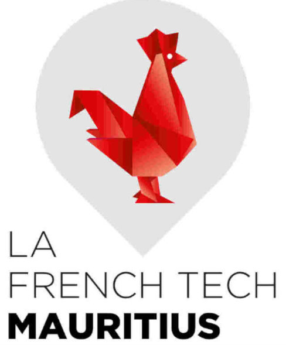
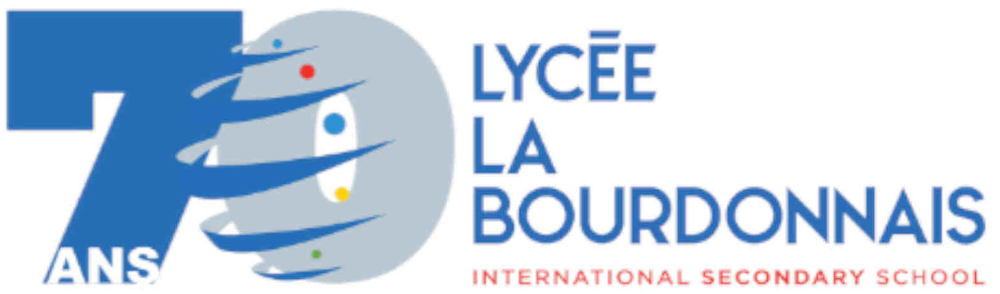

🎮 Finding a Treasure in the Void Simulator
Nuit du Code 2024 · Équipe R.S.A. · Python / Pyxel

Un jeu d'exploration et de minage en pixel art, réalisé en équipe à l'île Maurice.

🌍 L'histoire
Thomas arrive sur la planète Sylva, attiré par la rumeur d'un trésor caché. Avec sa morpho-pioche, il creuse à travers les différentes couches de la planète, récupère des pièces et améliore son équipement pour atteindre le mystérieux coffre enfoui dans les profondeurs.
🖼️ Aperçu du jeu

  
  
<em>Capture originale issue de notre documentation de la Nuit du Code.</em>

🕹️ Comment jouer ?
- Flèches directionnelles : se déplacer dans la carte.
- Clic sur les blocs : les casser pour récolter des pièces d'or.
- P : mettre le jeu en pause ou reprendre la partie.
- R : recommencer après avoir ouvert le coffre.
Le but est d'atteindre la couche la plus profonde, d'améliorer progressivement sa pioche et d'ouvrir le coffre.
⛏️ Minage et améliorations
L'outil actuel est affiché en bas à gauche. Lorsque suffisamment de pièces sont disponibles, le bouton d'amélioration passe du blanc au vert.

Certains matériaux exigent une pioche plus puissante :
Pioche en fer	Obsidienne
	

Par exemple, il faut une pioche en fer pour miner l'obsidienne. Au dernier niveau d'amélioration, tous les blocs deviennent minables sauf les blocs d'Eternium, indestructibles.

 
🛠️ Technologies
- Python : logique du jeu.
- Pyxel : moteur de jeu rétro, graphismes et interactions.
🧩 Défis rencontrés
- Réaliser le déplacement du personnage en faisant défiler le décor, un défi qui nous a pris environ deux heures.
- Concevoir une interface lisible malgré une palette de couleurs limitée.
🚀 Améliorations envisagées
- [ ] Créer un écran d'accueil.
- [ ] Ajouter des effets sonores.
- [ ] Ajouter une durabilité aux blocs et des étapes visuelles de leur destruction (les illustrations étaient déjà dessinées, mais n'ont pas pu être intégrées à temps).
👥 Équipe R.S.A.
- Raees Badat
- Sania Mattan
- Assim Aly
Projet réalisé lors de la Nuit du Code 2024, dans le cadre de notre scolarité au Lycée La Bourdonnais, à l'île Maurice.
📄 Documentation
La [documentation originale du projet](Documentation_RSA.pdf) présente le scénario, les commandes, les difficultés rencontrées et les améliorations imaginées par l'équipe.
🤝 Événement et partenaires

  &nbsp;&nbsp;
  

Projet d'équipe réalisé dans le cadre de la Nuit du Code 2024. Les visuels du jeu sont repris des documents d'origine.